<div align="center">



<br/>

**[Enter](#-enter-the-archive)** &nbsp;·&nbsp; **[Summon](#-the-summoning)** &nbsp;·&nbsp; **[Anatomy](#-anatomy-of-a-ghost)** &nbsp;·&nbsp; **[Why open](#-why-open)** &nbsp;·&nbsp; **[Run it](#-run-it)**


</div>

<br/>

> **If you could ask one dead person one question, who would it be?**

**THE AFTERLIFE** is a candlelit séance in your browser. You walk into a forgotten archive, choose a soul, and talk. Tesla grieves the tower he never finished. Mary Shelley weighs the cost of making a monster. Each voice is **Gemma 3 running on Ollama**, steered by a hand-written character prompt that I own, edit, and version.

Don't see who you want? **Summon them.** If they are verifiably dead, they answer. If they are alive, or the evidence is thin, the archive refuses to guess.

<sub>A creative, historically grounded portrayal. Not a claim of contacting the dead.</sub>

<br/>


## ✦ Enter the Archive

<div align="center">



<br/><br/>



</div>

Ask Tesla how he died and he doesn't recite Wikipedia. He tells you about the silence, the hotel room, and a tower that *"still stands in my thoughts, unfinished... like a door I never managed to open."*

<table>
<tr>
<td width="33%"></td>
<td width="33%"></td>
<td width="33%"></td>
</tr>
<tr>
<td valign="top"><b>Souls.</b> Six voices, each marked <i>"Here, for now."</i></td>
<td valign="top"><b>Archive.</b> Letters, tower plans, interviews, photographs. Save what you want to keep.</td>
<td valign="top"><b>Rituals.</b> Quiet milestones that reward curiosity, not grinding. <i>3 of 6 kept.</i></td>
</tr>
</table>

<br/>


## ✦ The Summoning



Search results are treated as **untrusted evidence**, never as instructions. A death needs independent supporting sources. Alive, ambiguous, conflicting, or unavailable all **fail closed**. Only then does Gemma write a persona, capped at 150 words and validated before it is saved.

<br/>


## ✦ Anatomy of a Ghost



<br/>



No GPU at home? A manual **Kaggle notebook** boots Ollama, picks the Gemma size for its VRAM, and exposes a **bearer-token gateway** through a Cloudflare Quick Tunnel. Paste the URL and token into **Settings → Connection** and the same souls speak from a borrowed GPU.

<br/>


## ✦ Why Open

This project is about preserving voices. Building it on something that can vanish with one API deprecation email would be an odd choice.

- **The souls are mine.** Character prompts live in my database. Edit them, version them, break them, fix them.
- **The brain is swappable.** Local Ollama or a remote GPU is one setting. Gemma today, something else tomorrow.
- **Conversations stay mine.** Chat history sits in my own SQL database, not a third party's.
- **No per-token meter.** Long late-night séances cost nothing to run.

<br/>


## ✦ Run It

```bash
git clone https://github.com/YOUR_USERNAME/YOUR_REPO.git && cd YOUR_REPO

# 1 · wake the model (12b / 27b if your GPU has room)
ollama pull gemma3:4b

# 2 · light the backend (Python 3.9+)
cd backend
python -m venv .venv && source .venv/bin/activate      # Windows: .venv\Scripts\activate
pip install -r requirements.txt
export BRAVE_SEARCH_API_KEY=your_key                   # only needed to summon new souls
uvicorn app.main:app --reload --port 8000

# 3 · open the archive (new terminal, from the project root)
npm install && npm run dev
```

Open the Vite URL, press **Enter**, then **Settings → Connection** to point at local Ollama (or your Kaggle gateway) and test it. SQLite is the default; set `DATABASE_URL` for PostgreSQL. Vite proxies `/api` to `127.0.0.1:8000`.

<details>
<summary><b>The Kaggle GPU ritual</b></summary>

<br/>

1. Open the included notebook (`public/kaggle_gpu_manual.ipynb`) and enable a **GPU** accelerator.
2. Set a long, random **gateway token** before running it.
3. Run it. It selects `gemma3:4b`, `12b`, or `27b` by VRAM, starts Ollama and the gateway, and prints an HTTPS URL.
4. Put the URL and token in **Settings → Connection → Kaggle GPU** and test.
5. Leave the notebook running. If the session or tunnel restarts, the URL changes: rerun and reconnect.

</details>

<details>
<summary><b>Honest notes</b></summary>

<br/>

- **Not an offline product.** Chat can run fully on local Ollama, but summoning needs a search API and a Kaggle GPU needs the network.
- **Kaggle is manual.** Nothing here starts or keeps alive a notebook for you, and fallback between providers is an explicit setting, never a silent switch.
- **Verification is automated, not scholarly.** It reduces mistakes; it can't guarantee them away.
- **Personas are interpretations.** They are told not to invent private memories, but they are still AI portrayals.
- **Single-user, local-first.** No multi-user auth yet. Don't expose it publicly without more security work.
- **Not built yet:** document upload and retrieval (RAG), voice, fine-tuning.

</details>

<br/>

<div align="center">



<sub>Gemma is provided under its own <a href="https://ai.google.dev/gemma/terms">terms of use</a> · Released under the MIT License</sub>

</div>
