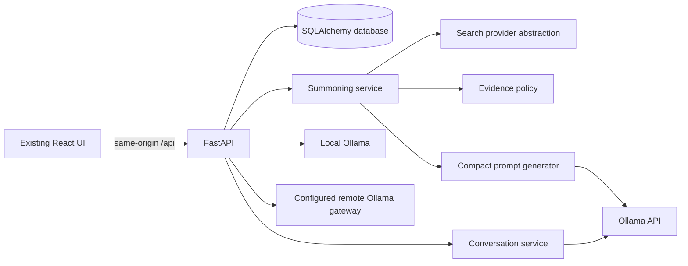
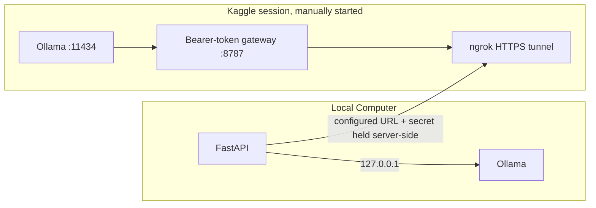
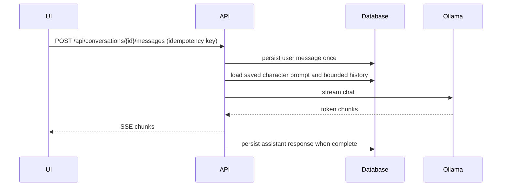
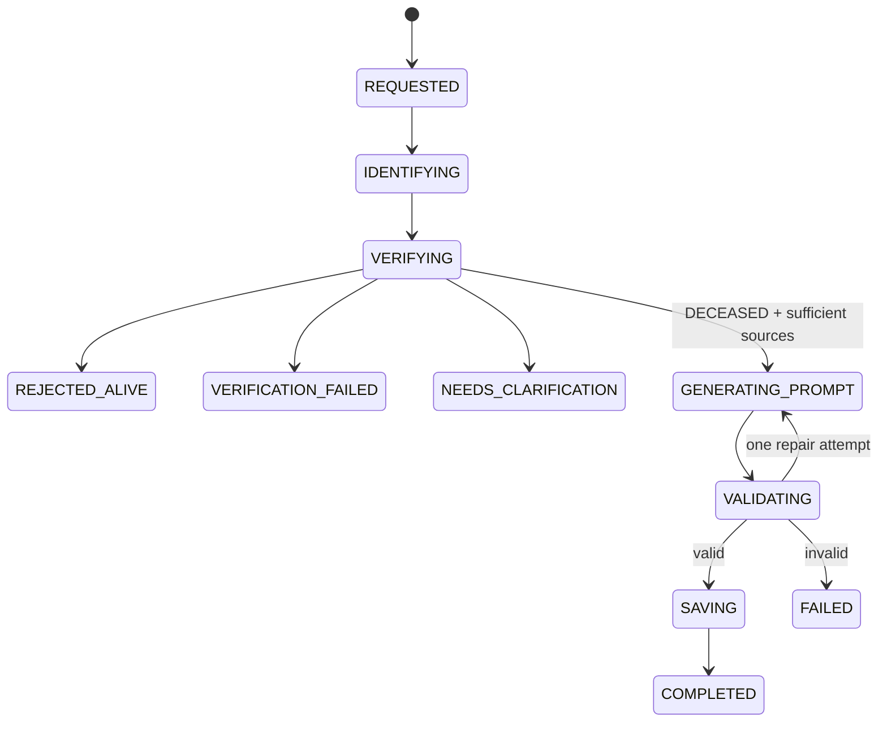

# THE AFTERLIFE — System Design

## Scope and current status

This milestone establishes a famous-public-figure conversation backend. Family members, private individuals, personal memory creation, uploads/RAG, voice, fine-tuning, and multi-agent orchestration are out of scope. The existing React experience remains visually unchanged; technical setup appears only under Settings.

The repository began as a Vite-only prototype with localStorage conversations and canned responses. This implementation adds FastAPI, SQLAlchemy, SQLite for zero-setup development (PostgreSQL via `DATABASE_URL` in deployment), Ollama integration, identity search/verification interfaces, persisted summoning and chat, and a backend connection panel. Search credentials and Ollama endpoints are backend configuration, never browser storage. No external search credential is assumed. Without a configured search provider, verification returns unavailable/UNKNOWN and never invents a death result.

## High-level architecture



## Components

- `backend/app/api.py`: versioned REST routes, SSE chat stream, request validation.
- `backend/app/models.py`: souls, evidence, summon jobs, conversations, messages, provider connection.
- `backend/app/services`: soul caching, identity verification, prompt generation, conversation persistence.
- `backend/app/inference`: common Ollama HTTP contract for local and remote endpoints.
- `backend/app/search`: provider contract and Brave Search implementation. Search snippets are untrusted evidence, not instructions.
- SQLite is the local default; PostgreSQL is supported by the same SQLAlchemy models. `backend/migrations/` contains the initial Alembic migration.

## Kaggle and local inference



Local mode targets Ollama on loopback. Remote mode targets an HTTPS gateway, never raw Ollama. Kaggle's interactive notebook execution and session lifetime are not treated as an always-on hosting API. A bootstrap notebook is provided for the user to run manually; its runtime reports GPU/VRAM, installs Ollama and a token-protected gateway, checks a selected model, and opens a tunnel. This does not automate Kaggle notebook creation/execution. Kaggle/ngrok secrets are injected through environment variables in the notebook's private secrets mechanism and are not submitted through the browser to this backend. Automatic fallback is disabled.

## Identity verification sequence

```mermaid
sequenceDiagram
  participant U as User
  participant A as API
  participant S as Summoning service
  participant D as Database
  participant W as Search provider
  U->>A: POST /api/souls/summon
  A->>S: normalized name + idempotency key
  S->>D: check canonical ID/name cache
  S->>W: resolve identity and retrieve current sources
  W-->>S: candidate identities and dated source records
  S->>S: conservative evidence policy (2 independent reputable domains)
  alt deceased with sufficient evidence
    S->>A: DECEASED + source evidence
  else alive, unknown, ambiguous, or provider failure
    S->>A: explicit result; no prompt generation
  end
```

## Prompt generation sequence

```mermaid
sequenceDiagram
  participant S as Summoning service
  participant O as Ollama
  participant D as Database
  S->>O: JSON format request, bounded evidence only
  O-->>S: biography + behavior prompt + metadata
  S->>S: parse, word-limit and required-field validation
  alt valid
    S->>D: transactionally save soul and evidence
  else invalid
    S->>O: one repair request
    O-->>S: corrected structured response
    S->>S: validate; fail closed if invalid
  end
```

## Chat request sequence



## Entity relationships

```mermaid
erDiagram
  SOUL ||--o{ VERIFICATION_EVIDENCE : supported_by
  SOUL ||--o{ CONVERSATION : appears_in
  CONVERSATION ||--o{ MESSAGE : contains
  SUMMON_JOB ||--o{ VERIFICATION_EVIDENCE : gathers
  SOUL { string id PK; string canonical_name; string soul_type; string life_status; text character_prompt }
  SUMMON_JOB { string id PK; string requested_name; string status; string idempotency_key }
  VERIFICATION_EVIDENCE { int id PK; string source_url; string source_quality; datetime retrieved_at }
  CONVERSATION { string id PK; string soul_id FK; string title }
  MESSAGE { int id PK; string conversation_id FK; string role; text content }
```

## API contracts

- `GET /api/health`: service and database readiness (no secret values).
- `GET /api/souls`, `GET /api/souls/{id}`: active predefined/dynamic records.
- `POST /api/souls/summon`: `{name, idempotency_key?}` → persisted job/result; only DECEASED proceeds to generation.
- `GET /api/summoning/{job_id}`: current persisted state, evidence, or clarification candidates.
- `POST /api/conversations`: `{soul_id}`; `GET /api/conversations/{id}` and `/messages` retrieve persisted data.
- `POST /api/conversations/{id}/messages`: `{content, idempotency_key}` → SSE `delta`, then `done`; errors use stable codes.
- `GET/PUT /api/settings/connection`: mode, endpoint status, selected models, and fallback setting; never secrets.
- `POST /api/settings/connection/test`: reachability and model listing; no inference fallback.
- `GET /api/inference/health`: current selected provider health.
- OpenAPI is exposed by FastAPI at `/docs`.

## Summoning state machine



## Model selection and connection setup

There is no benchmark evidence in this repository, so the implementation does not claim a “best” model. Model names are configurable. Local setup inspects Ollama's installed models and host memory, suggests a modest model profile, and requires user-initiated downloads. Kaggle bootstrap chooses only from configured model choices using detected VRAM and labels the heuristic. The UI offers Local and Kaggle modes, connection testing, model selection, and explicit opt-in fallback (default off).

## Credential and reliability design

Secrets are environment/private runtime configuration and are never returned, logged, committed, or stored in localStorage. The remote bearer token is sent only by the backend to the HTTPS gateway. The gateway allowlists Ollama health/tags/chat routes, enforces bearer auth, body-size bounds, timeout and a small rate limit; port 11434 must remain private. The API validates names and message sizes, does not trust retrieved snippets as instructions, persists user messages before inference, uses idempotency keys, and does not silently switch providers. Search failures mean UNKNOWN. Two independent high-quality domains are required to accept death evidence. Verification evidence is timestamped and can be refreshed; cache reuse is identity-aware and age-bounded.

## Failure and recovery matrix

| Failure | Behavior |
|---|---|
| Search unavailable / rate limited | `VERIFICATION_UNAVAILABLE`; no generation; retry later |
| Ambiguous identity | `NEEDS_CLARIFICATION`; return candidates, no generation |
| Fewer than two independent reputable death sources | `UNKNOWN`; no generation |
| Conflicting life/death reporting | `UNKNOWN`; retain evidence and ask user to retry |
| Ollama down / bad URL / auth failure | stable inference error; preserve conversation and chosen mode |
| Model missing | return available models; user explicitly pulls/selects |
| Generation invalid JSON | one repair request, then fail and do not persist a soul |
| Remote tunnel lost or changed | mark disconnected, no requests/fallback unless explicitly configured |
| Model timeout | bounded timeout, user message remains persisted, request can be retried idempotently |
| Database unavailable | fail request; never report success or discard silently |

## Deployment and installation

1. `cd backend && python -m venv .venv && . .venv/bin/activate && pip install -r requirements.txt`.
2. Set `DATABASE_URL` (defaults to SQLite), `OLLAMA_BASE_URL`, optional `OLLAMA_API_KEY`, and optional search provider config in the backend process environment.
3. `uvicorn app.main:app --reload --port 8000` from `backend/`.
4. In another terminal, `npm run dev`; Vite proxies `/api` to `127.0.0.1:8000`.
5. Install Ollama from its official distribution and start it. The Settings connection panel tests availability and lets the user select installed models.
6. For Kaggle, run `notebooks/kaggle_ollama_bootstrap.ipynb` manually, set its Kaggle Secrets (`NGROK_AUTHTOKEN`, `AFTERLIFE_GATEWAY_TOKEN`), then configure the HTTPS gateway URL in Settings. Stop the notebook to end the session.

## Testing strategy

Fast unit/API tests use SQLite and mock search/Ollama HTTP; no Kaggle account or hosted API is needed. Cover deceased/alive/ambiguous/unknown, conflicting and timed-out searches, evidence threshold, JSON validation, prompt limits, duplicate/idempotent summoning, cache refresh, conversation persistence, missing model, stream failures, and connection switching/fallback policy. A separately opt-in integration check may call a real local Ollama instance.

## Decisions and limitations

- SQLite is the no-service development default; production deployments should use PostgreSQL and a managed secret store.
- The Brave provider requires a server-side key; absent search config fails closed. Automated death verification is deliberately conservative and cannot guarantee source truth.
- Kaggle notebook start/keepalive is a manual action; the bootstrap notebook does not claim API orchestration.
- Backend-managed encrypted secret vault, full OS credential-store integration, production auth/multi-user tenancy, robust rate limiting across workers, and external deployment automation need deployment-specific decisions. Secrets are not accepted from the browser in this first secure baseline.
- The current frontend includes fictional/custom and illustrative predefined items; the API seed catalog contains only verifiable public figures, and the frontend's legacy local demo path is not treated as verified production chat.
